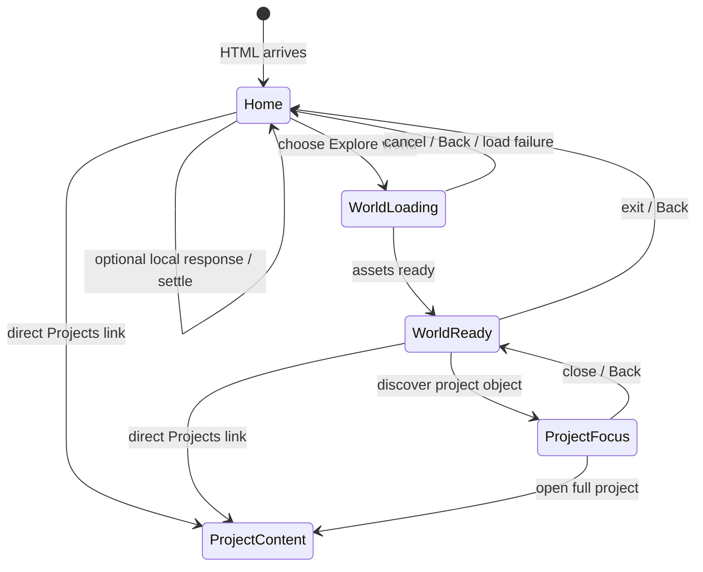

# H.1 — Performance-first hybrid experience plan

Planning checkpoint, 2026-10-28. This document proposes architecture and art direction; it does not approve public media or change the v2 runtime. Read with `AGENTS.md`, `DESIGN.md`, and `SCENE_FIRST_AUDIT.md`.

## 1. Experience architecture

| Layer | Visitor contract | Loading boundary |
| --- | --- | --- |
| A. Immediate homepage | Brandon's name, a concise introduction, authored static composition, semantic navigation, Projects, and Résumé work before enhancement starts. | Initial HTML, critical CSS, essential image only. |
| B. Progressive enhancement | One discoverable response reveals authentic context and can be reversed. Its failure leaves Layer A complete. | Import after first content is usable; initialize only when visible and allowed by motion/data preferences. |
| C. Optional world | A small explorable extension connects the same visual motif to one real project object and a focused semantic project view. Enter and return controls and browser Back are always available. | Explicit visitor entry; optional idle prefetch only after measuring competition with critical assets. |

The current optional Guardian remains a distinct lazy route. The world is not a replacement for Projects, Résumé, or Guardian. No backend, framework, or renderer is selected by this plan.

## 2. First-frame art direction and acceptance

**Proposed direction: a living project signal.** Use one approved project artifact as an authored visual motif that begins in a graphic, legible composition around Brandon's identity. Its shape, texture, and movement should arise from what the project actually does, not from a generic dashboard, fake screenshot, particle field, or decorative room. A small approved portrait detail may establish the person behind the work. The same motif should later become the world entry and its first discoverable object, so interaction and navigation feel connected. This is a design hypothesis, not a visual approval or a mandate to use Mapetite before media approval.

At first paint, a visitor must recognize Brandon Hann, understand his software/security/AI interests, and see Projects and Résumé without waiting or searching. The static composition must carry visual rhythm and project meaning without animation, and work at 390, 768, and 1440 px without turning into stacked generic cards. Do not repeat the giant selfie beside text, a desk, notebook, room, terminal, huge circles, or an isolated effect widget. Test real typography specimens: candidate Inter and JetBrains Mono against at least one alternative, including weight, width, tracking, line breaks, and navigation balance. The palette must be selected from approved material during H.2 visual review; no earlier palette is inherited.

Visual acceptance is separate from technical acceptance: review the first frame without motion, a recording of the complete interaction, recruiter clarity, originality relative to the two references, mobile layout, accessibility, and performance. If the first frame or interaction is ordinary, stop at the checkpoint rather than adding effects.

## 3. Current architecture and measured baseline

The verified branch is `experiment/scene-first` at `81efc780bc5457b39484b361923bfca327f71c64` before this document. It contains W.2A plus W.7 research, not the rejected W.6 implementation. `feature/welcoming-home` is `e85cefc`; W.6 is `3fc4d80`; the archive is `277f313`; `main` is `e687632`. The three untracked `artifacts/w3`, `w4`, and `w5` directories predate H.1 and are outside this diff.

`index.html` has an empty `#root`; `main.tsx` imports all homepage React, CSS, and both font families before `createRoot` renders `App`. `App` statically imports `WelcomingHome` and dynamically imports Guardian for `?experience=guardian`. The initial HTML contains a no-script résumé link, but no identity or Projects content. This is the clearest gap against the immediate-homepage contract.

`npm run build` passed (it includes `tsc --noEmit`). Vite 6.4.5 emitted: initial JS 213.01 kB uncompressed / 67.36 kB gzip; initial CSS 17.21 / 4.26 kB gzip; Guardian JS 29.28 / 8.83 kB gzip and CSS 23.13 / 5.57 kB gzip. The approved portrait copied to `dist/` is approximately 384 KiB on disk. Latin variable font files are 28.87 kB Source Sans 3 and 36.62 kB Fraunces. Additional language subsets are emitted but should only transfer if their `unicode-range` is needed. Guardian-specific build outputs include a 3.26 MB PNG and two roughly 0.75 MB JPGs; emitted files do **not** prove they transfer on homepage entry. Verify actual network requests before asserting separation is complete. The standalone résumé remains a separate public HTML/PDF path.

A single headless Chromium lab run at 390 × 844 used 150 ms RTT, 1.6 Mbps download, 0.75 Mbps upload, and 4× CPU slowdown against local Vite preview. Cold load: FCP and observed LCP 1,160 ms, CLS 0.118, observed long-task duration 76 ms. Repeat load in the same browser context: FCP/LCP 492 ms, CLS 0, observed long-task duration 0 ms. The cold request transferred about 67.7 kB JS, 4.6 kB CSS, and 66.1 kB of Latin fonts including response overhead. This viewport did not request the portrait before measurement. These are **one-run simulated local samples**, not p75 field data or a zero-latency claim. LCP's candidate may change with a different viewport, image placement, or hydration strategy; INP requires actual interaction sampling and was not measured. Local caching and hosting differ from GitHub Pages. No runtime performance improvement occurred in H.1.

## 4. Initial-load strategy and prerender decision

| Option | Advantage | Cost / risk |
| --- | --- | --- |
| Existing client-rendered Vite SPA | Simple build and one React runtime. | HTML has no useful homepage content until JS downloads, parses, and renders; JS failure removes identity and Projects. |
| Build-time prerendered initial HTML, then progressive React enhancement | Semantic content and links are available before JS; static composition survives enhancement failure; better crawlability. | Needs a deterministic, browser-independent render entry, hydration parity, asset/base-path checks, and care with hash/history initialization. |

**Provisional decision:** prototype build-time prerendering in H.2 without a new framework. Render a focused semantic homepage shell from the same typed content contracts used by React, write it at build time, then hydrate or attach scoped enhancement. Do not maintain a hand-copied second set of project facts. Keep `window`, media queries, random values, and pointer state outside server/build rendering. If the narrow proof creates excessive hydration complexity, compare a no-framework static HTML entry generated from the same data against the SPA using measured cold loads and no-JS behavior before committing to either. Every generated link must respect `/brandonhann.github.io/`; a direct hash and browser Back must select the same content after hydration.

Initial priorities: semantic text and navigation; minimal critical CSS; one dimensioned, responsive, compressed approved visual; local subset fonts with `font-display` and reserved metrics; stable image aspect ratios. Defer below-fold images, Guardian art, world JS/models/textures, video, and external services. Test whether image preload improves actual LCP before adding it. No fake percentage or splash. Cache immutable hashed assets aggressively where Pages supports it, while verifying HTML freshness and repeat visits.

## 5. Proposed module boundaries

These are responsibilities for H.2/H.3, not folders to create in H.1.

| Boundary | Responsibility |
| --- | --- |
| Experience shell / URL controller | Parse route/query/hash, own durable navigation and selected-project state, push/replace history, restore Back/Forward and focus. Guardian and world remain optional branches. |
| Static hero presentation | Deterministic semantic HTML and first-frame CSS; direct Projects/Résumé links; fallback visual and reserved media dimensions. |
| Enhancement controller | Feature-scoped renderer and lifecycle: initialize after content, wake on input, settle and stop, pause hidden/offscreen, dispose fully. No navigation facts inside drawing code. |
| Input adapter | Normalize pointer, touch, keyboard, and explicit controls to small semantic actions; no per-pointer React rerender. |
| Scene/transition reducer | Explicit `home`, `world-loading`, `world-ready`, and `project-focus` states; cancelable transitions and reversible return. High-frequency visual coordinates stay in refs/controller memory. |
| Asset loader | Demand-load optional modules and approved media, handle failure/abort, avoid duplicate fetches, expose a lightweight loading state without hiding the homepage. |
| Project content contract | Reuse `src/data/projects.ts` and public-safe `domain.ts` facts and stable IDs; one semantic project view and link set. |
| Accessibility/fallback | Accessible HTML controls, focus transfer and recovery, reduced-motion static states, no-renderer/no-JS path. |
| World and Guardian | Independent lazy modules, each able to fail or exit without harming the homepage. |

## 6. Interaction ladder and scene state



The visitor sees identity immediately, notices a discoverable cue in the approved artifact, receives prompt local feedback, and learns one authentic project fact. An optional world-entry control extends that same visual object into a small scene. Selecting the object shifts attention toward the same artifact, opens semantic project content, and returns to the prior world or home state. The transition may crossfade/transform, but navigation is active throughout and never waits for animation completion. Touch has a visible tap target; keyboard has focus and activation; reduced motion uses a direct state change. World state encoded in URL/history must permit Back and direct return; visual interpolation is transient and cancelable.

## 7. Renderer trade-offs

| Technology | Suitable requirement | Cost / decision |
| --- | --- | --- |
| CSS + SVG | Static authored graphic, semantic overlay, object focus transforms, masks, modest local response. | First H.2 proof. Smallest runtime, easy fallback; avoid elaborate CSS illustration. |
| Canvas 2D | Approved image needs true pixel-level reveal or many tightly coordinated fragments. | Use only as a progressive layer with static HTML/image beneath; bound DPR and frame work, sleep at rest. |
| WebGL / Three.js | A reviewed world concept genuinely needs spatial depth, camera, and many shared visual objects that CSS/Canvas cannot deliver well. | Candidate only for optional H.3 module. Higher memory, shader/asset cost, device and accessibility fallback. Never on the initial content path. |

The rendering interface should consume approved art and semantic scene actions; it must not own project facts or URL state. This makes a future renderer replaceable.

## 8. Asset dependency graph and media gate

```text
HTML + critical CSS + text/nav + dimensioned approved first-frame art
  ├─ local Latin font subset(s) (swap/fallback with reserved layout)
  ├─ after usable: lightweight interaction module (if supported)
  ├─ on deliberate entry: world JS → approved world art/models → project object
  └─ on Guardian route only: Guardian JS/CSS → Guardian art
```

Ready: public-safe typed project facts, existing résumé paths, and Brandon's approved portrait. Private review candidate: W.7A Mapetite search/results/map/detail JPGs and interaction WebM in ignored `artifacts/w7a-review/`; the open-map capture is recommended for review, **not approved for public reuse**. It includes third-party map tiles and attribution; venue names, images, and logos need rights/content review. Missing: owner-selected Mapetite capture/crop/public-use decision, a verified caption and attribution plan, and any world-specific original art. Do not publish private captures, fabricate software evidence, or load project media merely because it exists locally. One strong approved artifact is enough for the first slice.

## 9. Accessibility and fallback

The no-JS and renderer-failure paths must retain identity, Projects, Résumé, and semantic project details. Every visual affordance has a labelled control and visible focus; no drag-only action. Alternative inputs should reach equivalent content without mimicking a physical gesture. Keep touch scrolling native, offer an explicit reveal/enter action, and allow Escape/Back/exit to reverse focus. Reduced motion disables camera travel and continuous effects while preserving the visual composition. Consider `prefers-reduced-data`, low-memory hints, and WebGL failure as reasons to avoid optional media work, with feature detection rather than user-agent branches. Announce loading or failure briefly without trapping focus. Dispose listeners, observers, timers, frames, GPU resources, and in-flight requests when exiting.

## 10. Performance contract and measurement

Core Web Vitals **targets**, not measurements or promises: LCP ≤ 2.5 s, INP ≤ 200 ms, CLS ≤ 0.1 at p75. The observed one-run cold CLS of 0.118 warrants investigation before adding visual layers. Do not set hard new transfer budgets from one sample. H.2 should first collect 5+ repeatable cold and warm lab runs at 390 px with a declared network/CPU profile and at least one 1440 px desktop profile, then propose budgets for initial JS, critical image, and main-thread work using the measured distribution and design needs. Test a no-JS load and an enhancement-failure load.

Track FCP, LCP element, CLS sources, JS and image transfer, long tasks, interaction latency, navigation response, animation frame distribution during interaction, and zero/near-zero frame activity after settling or offscreen. Use Chrome trace/Lighthouse or Web Vitals instrumentation for lab checks; use real-user field data only if later approved with a privacy review. Separate cold cache from repeat visits and homepage from world entry. Do not infer INP from a synthetic tap alone or claim p75 from localhost. Recheck on GitHub Pages preview once a non-production publish path is separately approved.

## 11. GitHub Pages compatibility

Vite currently builds with `base: '/brandonhann.github.io/'`. Keep hashed assets and copied public URLs under that prefix, including résumé and optional module URLs. Build-time prerender must emit the correct base path and preserve direct hash navigation; a static Pages host has no server rewrite for arbitrary client routes. Prefer query/hash state for optional experiences or publish concrete HTML entry points. Test direct loads, Back/Forward, refresh, and no-JS links under the subpath. This plan does not alter Pages settings or release branches.

## 12. Risk register

| Risk | Mitigation / gate |
| --- | --- |
| Static HTML and React hydration disagree | Deterministic render, one content source, browser test for hydration warnings and direct links before rollout. |
| A visually striking asset harms LCP/CLS | Responsive compression, reserved dimensions, image candidate testing, static first-frame review and timing before expansion. |
| World competes with homepage download/CPU | Separate chunk and asset graph; explicit entry; measure any proposed idle prefetch on mobile before enabling. |
| Optional renderer fails or never settles | Semantic fallback, feature detection, visibility pause, lifecycle tests and idle frame measurement. |
| Composition repeats rejected experiments | H.2 visual gate with static and recorded interaction; owner approval before H.3. |
| Map/venue media published without permission | Keep private review files ignored; select exact asset, crop, attribution, and public-use approval first. |
| GitHub Pages subpath/history breaks | Built-artifact and browser tests for direct URLs, Back, résumé, Guardian, and refresh. |

## 13. Staged implementation and stop gates

1. **H.1 — Architecture and art-direction planning (this checkpoint):** documentation and measured baseline only. Owner reviews the architecture and creative direction.
2. **H.2 — Initial-screen prototype:** build a static first frame and one approved lightweight interaction on the actual homepage. Compare SPA and focused prerender proof, measure initial load independently of visual appeal, and stop for approval.
3. **H.3 — World entry prototype:** optional lazy world module, one coherent transition, and one meaningful object; no world asset on the homepage critical path. Stop for approval.
4. **H.4 — Project discovery:** integrate one approved authentic project artifact, direct semantic project navigation, and reversible return. Verify links and media attribution.
5. **H.5 — Polish and release evaluation:** review accessibility, visual quality, mobile, browser history, performance, cleanup, public asset permission, and GitHub Pages behavior. Release requires separate authorization.

No H.2 implementation should start until the owner approves this plan and the first public project asset's use is resolved.
